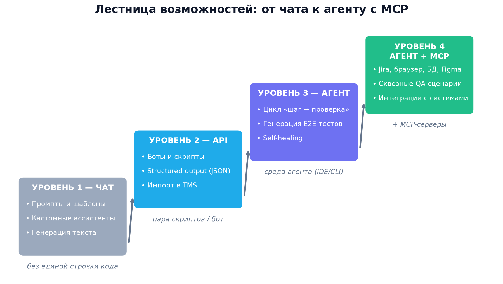
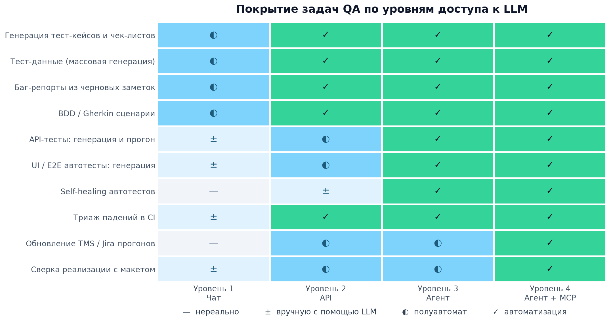
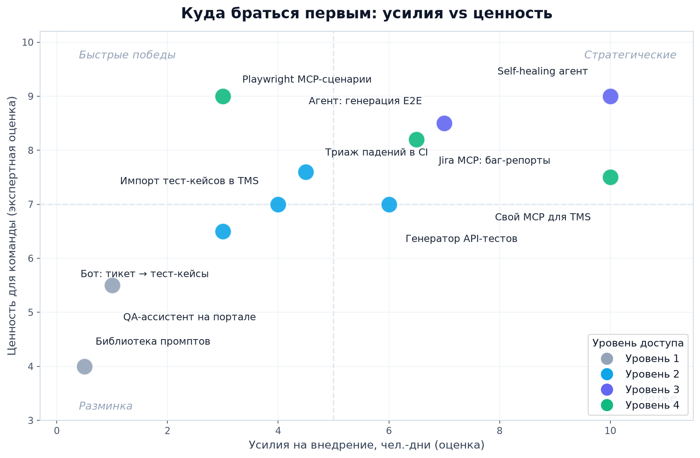
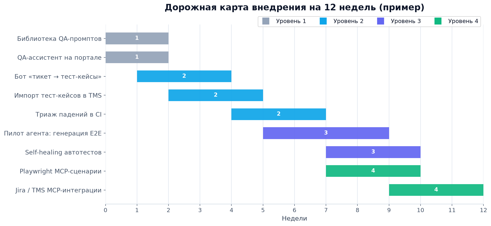

# AI-инструменты для ручных тестировщиков: что можно собрать самостоятельно

**Обзор по уровням доступа к LLM: чат → API → агентский режим → агентский режим + MCP**

*Октябрь 2026 · Формат: основа для презентации · Графики для слайдов: папка `assets/`*

---

## TL;DR

| Уровень | Что добавляется | Что собираем для QA | Усилия на старт |
|---|---|---|---|
| **1. Чат** | диалог с LLM | промпт-библиотеки, кастомные ассистенты, генерация тест-кейсов и данных | часы, без кода |
| **2. API** | LLM как «умная функция» в коде | боты, скрипты, импорт тест-кейсов в TMS, триаж CI | дни |
| **3. Агент** | цикл «действие → проверка» | генерация E2E-тестов, self-healing, автоисследование приложения | недели |
| **4. Агент + MCP** | доступ к внешним системам | Jira, браузер, БД и Figma в одном сценарии; сквозная автоматизация | недели |

Ключевая мысль: **каждый следующий уровень умножает ценность предыдущего, а не заменяет его.** Начать можно с уровня 1 уже сегодня — без единой строчки кода.

---

## Уровень 1. LLM только с чатом (внутренняя LLM без API)

Условия: есть только окно диалога — корпоративный LLM-портал, ChatGPT, Claude и т.п. Без плагинов, без интеграций, без кода.

### Что реально собрать

| Инструмент | Что делает | Как собрать |
|---|---|---|
| **Библиотека QA-промптов** | готовые шаблоны: тест-кейсы, чек-листы, BDD, баг-репорты, тест-данные | документ/вики с проверенными промптами под ваши форматы |
| **Кастомный QA-ассистент** | «выделенный» помощник с постоянной инструкцией и стилем ответа | ассистент на LLM-портале с системным промптом (аналог Custom GPT / Claude Project) |
| **Генератор тест-кейсов** | требования → таблица кейсов с приоритетами и граничными значениями | промпт-шаблон + вставка требований; выгрузка в Markdown/CSV |
| **Генератор тест-данных** | массивы данных с ограничениями (телефоны, ИНН, edge-cases) | промпт с правилами формата, выгрузка таблицей |
| **«Собиратель» баг-репортов** | черновые заметки со скриншот-описаниями → структурированный репорт | шаблон репорта в системном промпте ассистента |
| **Помощник research-тестирования** | чартеры, риск-листы, questions-to-ask перед тестированием фичи | промпт «составь чартер по этой фиче» |

> 💡 Готовый набор из 38 проверенных промптов под эти задачи собран в каталоге [MANUAL_QA_PROMPTS/](MANUAL_QA_PROMPTS/README.md) — 13 классов задач, источники с GitHub-звёздами и популярными статьями.

### Реальные примеры (существуют, повторяемы в чате)

- **qa-prompt-library** — открытая библиотека промптов для QA ([github.com/tayyabakmal1/qa-prompt-library](https://github.com/tayyabakmal1/qa-prompt-library));
- **awesome-chatgpt-prompts-ru** — русскоязычная коллекция из сотен промптов-ролей (файл `prompts_ru.csv`), включая роль тестировщика ([github.com/smartmanru/awesome-chatgpt-prompts-ru](https://github.com/smartmanru/awesome-chatgpt-prompts-ru));
- **«15 промптов ChatGPT для QA»** — подборка на Хабре: анализ требований, тест-дизайн, баг-репорты, тест-данные, регресс-чек-листы, отчётность ([habr.com/ru/articles/986376/](https://habr.com/ru/articles/986376/));
- **«5 мощных промптов ChatGPT для тестировщиков»** — готовые промпты для тест-кейсов, тестовых данных и документации ([qarocks.ru](https://qarocks.ru/chatgpt-prompts-for-qa/)).

### Чего НЕ получится

- автоматических действий: всё через копипаст;
- доступа к Jira, TMS, CI, базам данных;
- работы с длинными документами сверх лимита контекста;
- стабильного формата вывода без контроля (зато structured-промпты + таблицы решают большую часть).

---

## Уровень 2. Доступ к API (без агентского режима)

Условия: можно вызывать LLM из кода, но **один запрос — один ответ**. Никаких циклов и действий — «склейку» делает ваш скрипт.

### Что реально собрать

| Инструмент | Что делает | Реальный аналог |
|---|---|---|
| **Бот «тикет → тест-кейсы»** (Telegram/Slack) | вставил описание тикета — получил тест-кейсы | корпоративные QA-боты |
| **Импортер в TMS** | требования → JSON (structured output) → автосоздание кейсов в TestRail/Zephyr/Xray | фичи «AI-generate» в TMS |
| **Триаж падений в CI** | упал тест → скрипт отправляет лог → комментарий с диагнозом в PR | ReportPortal — AI-анализ падений ([reportportal.io](https://reportportal.io)) |
| **Расширение браузера** | выделил текст/форму → баг-репорт по шаблону | — |
| **Генератор API-тестов** | OpenAPI-спека или запись трафика → кейсы и проверки | Keploy — генерация тестов из трафика ([keploy.io](https://keploy.io)) |
| **LLM-шаги в Playwright** | шаги на естественном языке через вызовы API | auto-playwright ([github.com/lucgagan/auto-playwright](https://github.com/lucgagan/auto-playwright)) |
| **Генератор тест-данных** | батчами, с валидацией по JSON Schema | — |

### Ключевые приёмы, которые делают уровень 2 надёжным

- **Structured Output / JSON Schema** — модель возвращает машиночитаемый JSON, который скрипт заливает прямо в TMS;
- **few-shot примеры** ваших реальных тест-кейсов — резко повышает качество формата;
- батчинг (пакетная обработка требований) и кэширование повторяющихся запросов.

### Чего НЕ получится

- агент не проверит результат своих же действий (нет цикла «сделал → посмотрел → исправил»);
- сложные многошаговые сценарии придётся оркестрировать своим кодом.

---

## Уровень 3. Агентский режим

Условия: LLM работает в цикле **«действие → наблюдение → решение»** с инструментами: файлы, терминал, браузер, запуск тестов. Примеры сред: Claude Code, Cursor Agent Mode, GitHub Copilot Agent Mode, открытые фреймворки.

### Что реально собрать

| Инструмент | Что делает |
|---|---|
| **Генерация E2E-тестов** | агент читает фичу/код, запускает приложение, пишет Playwright-тесты, гоняет и доводит их до зелёного |
| **Self-healing** | упал тест из-за нового UI → агент сам читает ошибку, чинит локаторы, обновляет тест |
| **Поддержка регресса** | рефакторинг и актуализация автотестов под изменённые флоу |
| **Автоисследование** | агент «кликает» по приложению и выдаёт тест-план / список подозрительных мест |
| **Агент-«стажёр» в CI** | упавший прогон → локализация причины и предлагаемый фикс |

### Реальные примеры (открытые, можно развернуть у себя)

- **Playwright Test Agents** — официальные агенты Playwright: *planner* (исследует приложение → markdown тест-план) → *generator* (план → тесты) → *healer* (чинит падения) ([playwright.dev/docs/test-agents](https://playwright.dev/docs/test-agents));
- **Midscene.js** (ByteDance web-infra) — vision-driven GUI-агент для E2E-тестирования web/мобильных/десктоп-приложений ([github.com/web-infra-dev/midscene](https://github.com/web-infra-dev/midscene));
- **Magnitude** — AI-native тест-фреймворк: браузерный агент с встроенным test runner ([magnitude.run](https://magnitude.run));
- **TestZeus Hercules** — открытый «тестировщик-агент»: принимает тесты на естественном языке для UI, API, a11y, security ([github.com/test-zeus-ai/testzeus-hercules](https://github.com/test-zeus-ai/testzeus-hercules));
- коммерческие аналоги подхода: Qodo, mabl, KaneAI и др. — ориентир того, что можно собрать самим.

### Чего НЕ получится

- агент «не видит» внешние системы, пока вы не подключите их сами (Jira, TMS, БД);
- действия в UI нестабильны и требуют ревью: агент может уверенно ошибаться.

---

## Уровень 4. Агентский режим + MCP

Условия: агент + **MCP (Model Context Protocol)** — стандартный способ подключать агента к внешним системам через готовые серверы-коннекторы. Появляются сквозные сценарии «от тикета до отчёта».

### Готовые MCP-серверы под QA-сценарии

| MCP-сервер | QA-сценарий | Статус |
|---|---|---|
| **Playwright MCP** (Microsoft) | агент открывает приложение, исследует, пишет и прогоняет тесты | официальный |
| **Chrome DevTools MCP** | автопроверка консоли, сети, производительности | официальный (Google) |
| **Atlassian MCP** | тикет из Jira → воспроизведение → дополненный баг-репорт | официальный |
| **GitHub MCP** | issues/PR, триаж, связка с кодом | официальный |
| **Figma MCP** | сверка реализации с макетом | официальный |
| **Sentry MCP** | новые ошибки прода → воспроизведение → репорт | официальный |
| **Postgres/MySQL MCP** | проверка данных, подготовка/чистка тест-данных | официальный/комьюнити |
| **Свой MCP над TMS** | агент сам обновляет тест-кейсы и прогоны | DIY (пример: TestCollab MCP — [testcollab.com](https://testcollab.com)) |

Каталог официальных серверов: [github.com/modelcontextprotocol/servers](https://github.com/modelcontextprotocol/servers)

### Связки-сценарии (реально собираются из готовых частей)

1. **«Планировщик»**: Playwright MCP исследует приложение → markdown тест-план → генератор создаёт тесты → healer их поддерживает (это штатный конвейер Playwright Test Agents);
2. **«Баг-хантер»**: Sentry MCP сообщает о новой ошибке прода → агент через Playwright MCP воспроизводит её → через Atlassian MCP заводит/обогащает баг в Jira;
3. **«Дизайн-ревьюер»**: Figma MCP даёт макет → агент сравнивает со скриншотами реальной страницы → список расхождений;
4. **«Хранитель тестов»**: GitHub MCP + свой TMS MCP → синхронизация тест-кейсов и результатов прогонов.

### Чего НЕ получится (без дисциплины)

- безопасно дать агенту **write**-доступы: начинать с read-only, действия — через подтверждение;
- предсказуемой стоимости: сквозные сценарии расходуют заметно больше токенов;
- гарантий качества: всё упирается в качество MCP-серверов и прав доступа.

---

## Сводное сравнение: покрытие задач QA по уровням

Выводы из карты:

- **Уровень 1 закрывает ~40 % рутинной «бумажной» работы** — уже этого достаточно, чтобы окупить внедрение;
- **Уровень 2 добивает интеграции**: то, что генерировалось в чате, начинает само попадать в TMS и CI;
- **Уровни 3–4 открывают класс задач, недоступный раньше вообще**: self-healing и сквозные сценарии через Jira/браузер/БД.

---

## Усилия vs ценность: с чего начать

Рекомендуемый порядок: **библиотека промптов → кастомный ассистент → бот + импорт в TMS → Playwright MCP-сценарии → self-healing → свой MCP над TMS.**

---

## Дорожная карта внедрения (пример на 12 недель)

---

## Риски и правила гигиены

| Риск | Правило |
|---|---|
| Галлюцинации (правдоподобный бред) | человек ревьюит всё, что уходит в TMS/Jira/код |
| Утечка данных | во внутреннюю LLM — без чувствительных данных; для API — корпоративный контур |
| Нестабильность UI-агентов | фиксированные наборы сценариев, скриншоты как доказательство, ретраи |
| Расход токенов | лимиты и кэш; дорогие модели — только там, где нужны |
| «Garbage in» | качество генерации = качество требований на входе; сначала навести порядок в требованиях |

Главный принцип: **LLM — усилитель тестировщика, а не его замена.** Финальное слово и ответственность — за человеком.

---

## Приложение: предлагаемая структура презентации (12 слайдов)

1. Титул — «AI-инструменты для ручных тестировщиков: что можно собрать самим»
2. Проблема и контекст: где AI реально помогает QA
3. 4 уровня доступа к LLM — картинка `assets/01_levels.png`
4. Уровень 1: чат — таблица «что собираем» + примеры
5. Уровень 2: API — таблица + аналоги (Keploy, ReportPortal, auto-playwright)
6. Уровень 3: агент — Playwright Test Agents, Midscene, Magnitude, Hercules
7. Уровень 4: агент + MCP — таблица MCP-серверов и связки-сценарии
8. Сравнение покрытия задач — `assets/02_heatmap.png`
9. Усилия vs ценность — `assets/03_effort_value.png`
10. Дорожная карта на 12 недель — `assets/04_roadmap.png`
11. Риски и правила гигиены
12. Выводы и следующие шаги

---

## Источники

- Playwright Test Agents — <https://playwright.dev/docs/test-agents>
- Playwright MCP (Microsoft) — <https://github.com/microsoft/playwright-mcp>
- Гайд по Playwright MCP для QA — <https://qaskills.sh/blog/playwright-mcp-server-guide>
- Демо Playwright MCP + Test Agents — <https://github.com/beinghumantester/Playwright_MCP_Server>
- Midscene.js — <https://github.com/web-infra-dev/midscene>
- Magnitude — <https://magnitude.run>
- TestZeus Hercules — <https://github.com/test-zeus-ai/testzeus-hercules>
- Keploy — <https://keploy.io>
- auto-playwright — <https://github.com/lucgagan/auto-playwright>
- ReportPortal — <https://reportportal.io>
- Chrome DevTools MCP — <https://github.com/ChromeDevTools/chrome-devtools-mcp>
- Каталог MCP-серверов — <https://github.com/modelcontextprotocol/servers>
- Sentry MCP — <https://mcp.sentry.dev>
- Figma MCP — <https://www.figma.com/mcp/>
- Atlassian MCP / Rovo — <https://www.atlassian.com>
- TestCollab MCP (свой MCP над TMS) — <https://testcollab.com>
- qa-prompt-library — <https://github.com/tayyabakmal1/qa-prompt-library>
- awesome-chatgpt-prompts-ru (рус.) — <https://github.com/smartmanru/awesome-chatgpt-prompts-ru>
- «15 промптов ChatGPT для QA», Habr (рус.) — <https://habr.com/ru/articles/986376/>
- «5 мощных промптов ChatGPT для тестировщиков», QaRocks (рус.) — <https://qarocks.ru/chatgpt-prompts-for-qa/>
